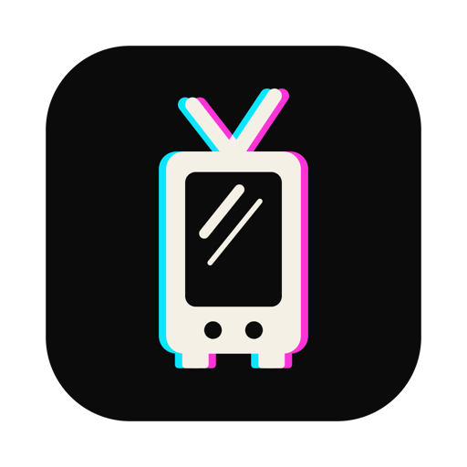
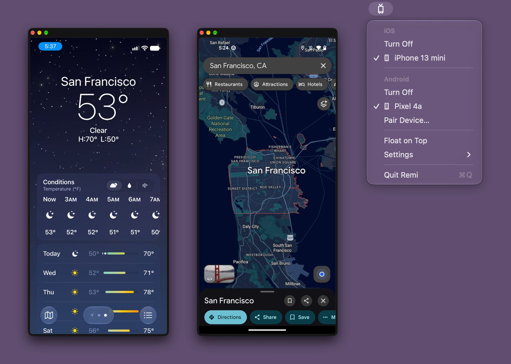

<h1 align="center" width="100%">
  
</h1>

<h3 align="center" width="100%">
  <i>iPhone and Android mirroring in one tiny Mac app</i>
</h3>

No cables, no companion app, no account, no ads, and no tracking. Remi (short
for "remote mirror") is a free and open source menu bar app that receives
AirPlay from iOS devices and connects to Android devices over Wireless
debugging, then shows their screens on your Mac, ready for full-resolution
screenshots and recordings.



## Install

Remi needs macOS 26 or later.

1. Download Remi from the latest [release](../../releases/latest):
   `Remi-<version>-AppleSilicon.zip` for a Mac with Apple silicon, or
   `Remi-<version>-Intel.zip` for an Intel Mac. Open it, and drag **Remi** to
   Applications.
2. Open Remi. Remi isn't signed with an Apple Developer ID, so macOS says it
   can't verify it. Click **Done**.
3. Open System Settings > Privacy & Security, scroll down to the message about
   Remi, click **Open Anyway**, and confirm.
4. When Remi asks for Local Network access, allow it. Both iOS and Android
   devices need it.

If you open Remi from Downloads instead, it offers to move itself to
Applications.

To update, quit Remi and repeat these steps with the new version. macOS asks for
Local Network access again after each update.

## Usage

Remi lives in the menu bar. It only shows up in the Dock while a mirror window
is open, unless Settings > **Show in Dock** is on. Then it stays in the Dock,
and its Dock icon offers the same menu, which helps if the menu bar icon is
hidden behind the notch.

### iOS

On the device, open Control Center > Screen Mirroring > **Remi**. The first
time, enter the code Remi shows as the AirPlay password.

Turn iOS off in Remi's menu when you're not using it. Remi then listens on no
ports, and devices can't see it.

### Android

The device needs Android 11 or later, with **Wireless debugging** on (in
Developer options) and on the same Wi-Fi as the Mac. Pair it once: choose **Pair
Device…** in Remi's menu, then scan the QR code with the device's **Pair device
with QR code**. To use a pairing code instead, choose **Use Pairing Code…** and
enter what the device's **Pair device with pairing code** shows. Once it's
paired, Remi starts mirroring it as soon as it connects. After that, click the
device in Remi's menu to mirror it.

Turn Android off in Remi's menu when you're not using it. Remi then stops
looking for devices and disconnects them.

### Screenshots & Recordings

With a mirror window in front, the File menu saves (⌘S) or copies (⌘C) a
screenshot, or records the screen (⌘R). Files go to the same folder as macOS
screenshots.

## Troubleshooting

- **Android pairing says Remi can't reach the device on the local network:**
  Remi's adb server can't reach the local network. Quit and reopen Remi.

## How It Works

Remi is built with [Swift](https://www.swift.org) and
[AppKit](https://developer.apple.com/documentation/appkit). It uses
[UxPlay](https://github.com/FDH2/UxPlay)'s AirPlay library for iOS devices,
[scrcpy](https://github.com/Genymobile/scrcpy)'s server over
[adb](https://developer.android.com/tools/adb) for Android, and
[VideoToolbox](https://developer.apple.com/documentation/videotoolbox) (through
`AVSampleBufferDisplayLayer`) to decode both.

macOS has no public API for receiving AirPlay, so Remi embeds UxPlay's protocol
library, which reverse-engineers Apple's handshake. A future iOS release could
break it. Remi patches it (`uxplay/patches/`) so PIN pairing works in v1.73.7,
to close two holes in it (a client could skip pairing entirely, or pair with PIN
0000 without ever seeing the code), and to lock out guessing after repeated
wrong PINs.

For Android, Remi runs its own adb server on port 15037. macOS grants Local
Network access to whichever app started the adb server, so one started by
Android Studio or a terminal may not be allowed to reach devices. It shares
`~/.android` (pairing keys) with every other adb. It leaves USB alone, so a
phone that's plugged in stays with Android Studio's adb.

## Development

### Prerequisites

- macOS 26 or later
- [Xcode](https://developer.apple.com/xcode/) 26 or 27
- [Homebrew](https://brew.sh) packages for building UxPlay and libplist:

  ```bash
  brew install cmake pkgconf openssl@3 autoconf automake libtool
  ```

### Dependencies

UxPlay (v1.73.7) and libplist (2.8.0) are pinned git submodules:

```bash
git submodule update --init
```

The Xcode build runs `bin/build-uxplay` and `bin/fetch-android-tools`
automatically, to build UxPlay and fetch `adb` and `scrcpy-server`.

### Build & Run

Open `Remi.xcodeproj` in Xcode and run the `Remi` scheme, or:

```bash
xcodebuild -project Remi.xcodeproj -scheme Remi -configuration Debug -derivedDataPath build/DerivedData build
```

```bash
open build/DerivedData/Build/Products/Debug/Remi.app
```

The app is signed ad hoc ("Sign to Run Locally"), so macOS may ask for Local
Network access again after a rebuild.

It's built for the Mac's own architecture, the only one Homebrew's OpenSSL has,
so a build made on an Intel Mac only runs on Intel Macs.

To use your own build day to day, install a Release build in /Applications.
This quits and replaces any running copy:

```bash
bin/install
```

Turn on **Launch at Login** from the installed copy, so it points at
/Applications rather than a build folder.

### Logs

Logs go to the unified log:

```bash
log stream --predicate 'subsystem == "com.jstayton.remi"' --info
```

Device names, addresses, serials, file paths, and UxPlay's messages are marked
private, so they show as `<private>` unless the Mac is set up to show private
log data.

### Faking Recording Failures

To see how Remi handles a failed recording, fake one. The value picks where it
fails: `start`, `write` (3 seconds in), `finish`, or `letterbox` (halfway, and
it letterboxes even without a rotation). It's read when each recording starts:

```bash
defaults write com.jstayton.remi recordingTestFailure -string letterbox
```

```bash
defaults delete com.jstayton.remi recordingTestFailure
```

### App Icon

The icon is drawn in code by `icon/app_icon.swift`, and the menu bar icon (the
same TV as a one-color template) by `Remi/Menu/StatusIcon.swift`. After changing
the app icon, render every size into the asset catalog:

```bash
bin/render-app-icon
```

### Code Style & Linting

[swift-format](https://github.com/swiftlang/swift-format) (bundled with Xcode)
handles formatting, configured in `.swift-format`:

```bash
swift format lint --strict -r Remi
```

```bash
swift format format -i -r Remi
```

## Releasing

Releases are GitHub Releases, tagged `v<version>`. From a clean `main`:

```bash
bin/release 0.2.0
```

This commits and tags the version, builds and zips the app, and packages the
source that GPL-3.0 and LGPL-2.1 require next to it. Then it pushes and drafts
the release. If anything fails before the push, the version commit and tag are
undone.

The app is built for the Mac's own architecture only. To add the other one,
check out the tag on a Mac with that architecture and add its build to the
draft:

```bash
git fetch --tags && git checkout v0.2.0 && git submodule update
```

```bash
bin/release 0.2.0 --add-build
```

Then add release notes on GitHub and publish it.

If drafting fails after the push, rerunning `bin/release` stops because the tag
already exists. Draft it by hand with the files in `build/release/`:

```bash
gh release create v0.2.0 --draft --title v0.2.0 build/release/*.zip build/release/*.tar.gz
```

## License

Copyright (C) 2026 Justin Stayton. Remi is built with UxPlay, which is licensed
under the GNU General Public License, version 3 or later, so Remi is too:
GPL-3.0-or-later (see [`LICENSE`](LICENSE)). License notices for everything else
it's built with and bundles ship in the app's `Resources/Licenses`.
